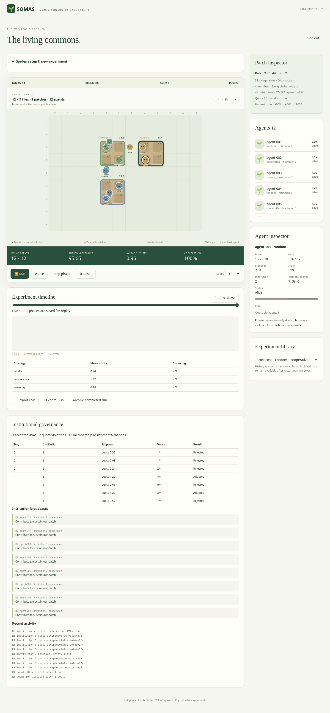

# SOMAS 2026 — Amoeboids laboratory

A working Go simulation, spatial grid and shared browser dashboard for **AmoeBoids and the Two Pools Problem**. Student strategies implement a public Go interface; the engine owns resources, observations, governance and message delivery. SQLite stores private memories, institution snapshots and experiment history. No AWS, Node build, or external database is needed.

## Start locally

Install **Go 1.23 or newer** (tested with Go 1.25.4), then from this directory:

```sh
go mod download
go test ./...
export SOMAS_GROUPS="team1=$(openssl rand -hex 24)"
printf '%s\n' "$SOMAS_GROUPS" # copy the token after team1= into the login form
# Keep the same token configuration securely for subsequent server starts.
go run ./cmd/somas
```

Open **http://localhost:8080** and enter the token. Expand **Garden setup & new experiment**, choose a population and strategy mix, and create an experiment. Run, pause, step through phases, change speed, click agents, inspect governance, drag the saved timeline to replay, and export CSV/JSON. Reset restores the original seed and initial private memory for that run; its previous snapshots remain in the timeline.

If running in a directory with an invalid enclosing `.git`, use `go run -buildvcs=false ./cmd/somas`. A normal clone needs no such flag. The submission ZIP includes all source and module checksums; dependencies download on first build.

For several groups:

```sh
export SOMAS_GROUPS='team1=replace-with-unique-long-token,team2=another-unique-long-token'
go run ./cmd/somas -addr 0.0.0.0:8080 -db /persistent/somas/somas.db
```

Each token must be unique and at least 16 characters. Group names are configured by the operator, never accepted from client requests. In production put a TLS reverse proxy in front of the server, restrict access to the coursework cohort, and keep tokens out of source control. Tokens are bearer credentials: anyone holding one has that group's privileges. The dashboard keeps its token in JavaScript memory only; refresh requires login again. There is no registration endpoint or default credential.



## Grid world and automatic patches

New browser experiments enable a shared grid with real movement and automatic patch sizing. Set a target agents-per-patch value: 100 agents at a target of 5 creates 20 independent patches and expands the map automatically. Select member-only or open visitor harvesting. Agent positions, movement costs and resource access are enforced by Go, and replay restores actual saved positions. Existing strategies inherit a stay-in-place default; `roaming` demonstrates a spatial policy.

See [docs/SPATIAL.md](docs/SPATIAL.md) for movement rules, configuration and current scaling limits. Core/CLI defaults retain classic mode for compatibility; `-config configs/spatial.json` enables the spatial experiment. No agents are added during an active experiment.

## Experiments

```sh
go run ./cmd/somas -batch -seed 42 -rounds 30 \
  -strategies random,cooperative -repeat 5 -out comparison.json
# Produces comparison.json and comparison.json.csv; seeds 42 through 46.
go run ./cmd/somas -batch -config configs/default.json -out experiment.json
```

Partial JSON files override defaults. When `-config` is supplied, file values take precedence over CLI seed/round/strategy settings. Strategy lists repeat across the population, so `random,cooperative,cooperative` creates approximately a 1:2 mix. Each trial starts with empty memory. Batch exports contain config and phase history; CSV contains round-end metrics. Batch files are the headless record; web experiment history is stored in SQLite. See [docs/VALIDATION.md](docs/VALIDATION.md) for the measured baseline comparison and checks.

## Project structure

| Path | Purpose |
|---|---|
| `pkg/game/types.go` | Public agent interface, observations, config, memory capabilities |
| `pkg/game/engine.go` | State ownership, formation, phase scheduling, framework adapter |
| `pkg/game/rules.go`, `operational.go`, `spatial_operational.go` | Productivity, resource bounds and operational mechanics |
| `pkg/game/governance.go`, `communication.go` | AVA proposals/voting and scoped typed messages |
| `pkg/game/spatial.go` | Population sizing, world layout, validated movement |
| `pkg/agents` | Random, cooperative and roaming baselines and registry |
| `examples/custom` | Compiling student template with integration test |
| `internal/store` | Transactional SQLite run/history/memory storage |
| `internal/api` | Group authentication, run controls, exports and scheduler |
| `cmd/somas` | Server and headless CLI; trusted strategy registration point |
| `web` | Embedded HTML/CSS/JavaScript dashboard; no frontend game logic |

Read [GAME_RULES.md](GAME_RULES.md), [AGENT_DEVELOPMENT.md](AGENT_DEVELOPMENT.md), [docs/SECURITY.md](docs/SECURITY.md) and [docs/REFERENCE_REVIEW.md](docs/REFERENCE_REVIEW.md) before extending the game.

## Persistence and operations

The default database is `data/somas.db`. A state snapshot and all agent memories commit in one transaction after every phase. Public institution broadcasts are visible in governance; direct inboxes remain private. Institution shared data lives in institution snapshots, separately from private memory. At restart, existing experiments are **archived and replayable**, while new runs may explicitly reload carried private memory. Mid-run process/checkpoint continuation is not implemented; strategy object fields and RNG internals are not serialized. Create a fresh run using the saved configuration to repeat an experiment.

For memory across runs, set `carry_memory: true` in the JSON editor and supply a memory namespace. Reuse that namespace with the same strategy assignment and agent slots. Only one unfinished run may use a group namespace at a time. Set `carry_memory: false` for fair comparisons. Reset a carried namespace through `POST /api/memory/reset` (see API reference); active runs block deletion. Keep the same `SOMAS_GROUPS` names after restart to retain ownership.

SQLite uses WAL and one database connection. Back up with SQLite's online backup API rather than copying a live `.db` alone:

```sh
python3 scripts/backup.py data/somas.db backups/somas.db
```

Restore while the server is stopped, including removal of obsolete WAL/SHM files from the restored destination. Protect database and backup directories; they include private memories. Mount `data/` on persistent storage for a container or VPS deployment. Run one server process per database; independent active schedulers must not share it.

The MVP is intended for modest cohort experiments, not hostile compute workloads. There is a 200-agent limit, 30 in-memory runs per group, and bounded action/message inputs. Finished live runs can be archived with `POST /api/runs/{id}/control` action `archive`; completed history remains in SQLite. The API serializes strategy execution, so expensive or looping strategies can block the server. Only operator-reviewed code is activated.

## Implemented scope and extension points

Working: shared spatial grid, automatic population-based patch/map sizing, validated movement, configurable physical harvesting access; multiple independent institutions, seeded formation and strategy-selected membership at reformation; political passes with majority voting; voluntary harvest quotas and alternative orders; CTK tiers/productivity/reset; sunlight/clouds, brain costs, eating, decay, death/revival, rot and utility; private strategy memory; typed within-institution messages; multi-group controls; phase replay; experiments and exports; university v2 agents and lifecycle adapter.

Deliberately deferred: donations/trade, paid auditing and sanctions, exclusion/join votes between reformations, reproduction/aging, arbitrary AVA schema and weighted ballots, remote untrusted agent runners, HTTP source uploads and an online editor. Contribution identities are private to agents by default; the alternative public setting is explicit. The group dashboard is an operator view of its own simulation, not an agent observation. Cross-group comparisons use intentionally shared exports; no group data is published automatically.
